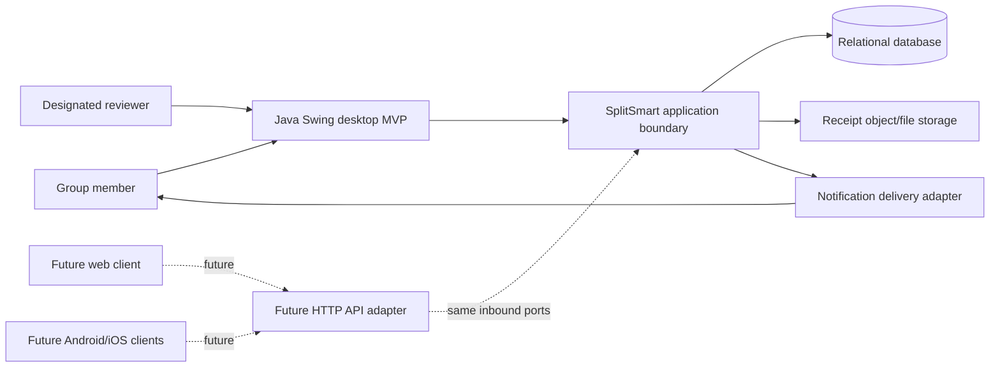
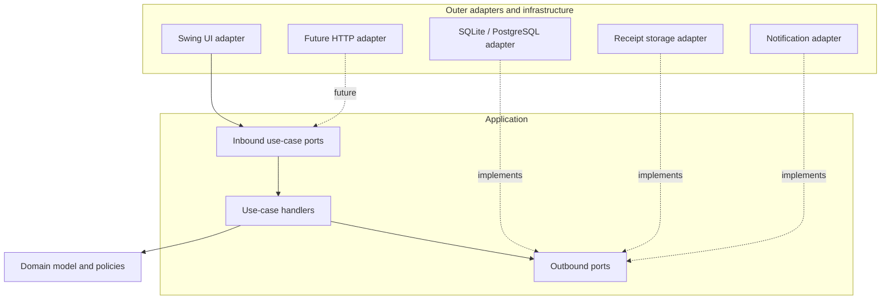
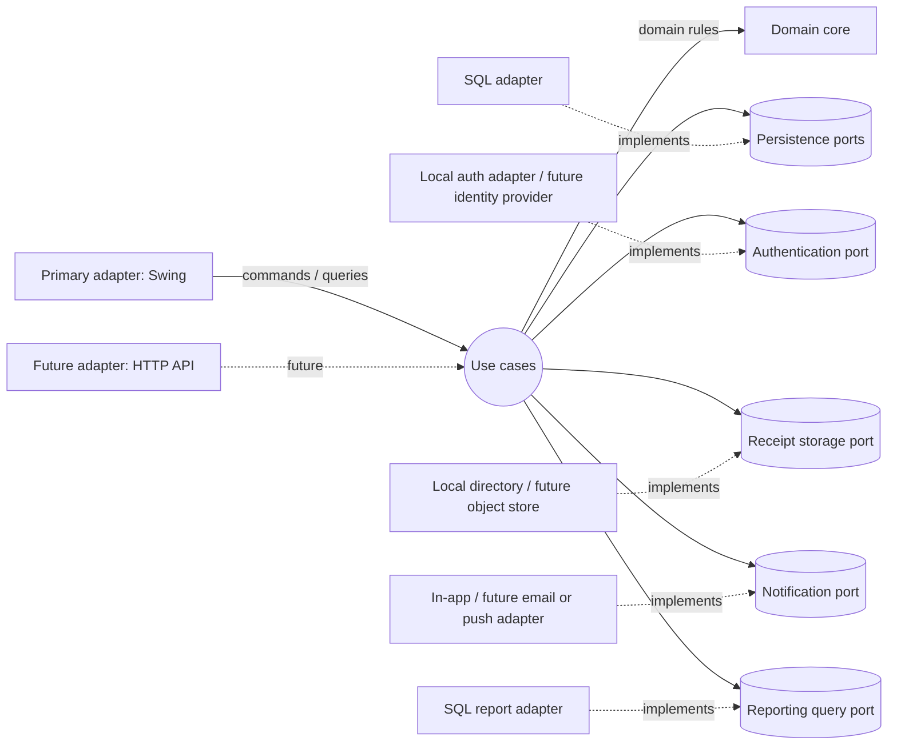
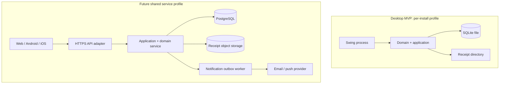

# SplitSmart Architecture B: Clean and Hexagonal Architecture

## Purpose and scope

This package proposes an independent architecture for SplitSmart. It follows the project constitution and `specs/001-split-expense-tracking/spec.md`. It is a design, not an implementation plan authorization: no application functionality is implemented here.

The specification defines both a Java Swing desktop MVP (`MVP-001`–`MVP-007`) and a broader web-first product with Android/iOS access (`INV-09`, `FR-012`). The MVP is the first delivery target, but the requirement inventory remains the product scope. No web/mobile clients are proposed for the MVP. The core application boundary is designed so they can later use the same use cases through a remote API.

Repository discovery found the constitution, the feature specification, its requirements checklist, and architecture prompts. No existing implementation plans, research, data models, contracts, or source code were present. Architecture A's prompt exists, but its generated artifacts do not. This design is independent and does not modify Spec Kit artifacts, the constitution, or the original requirements.

## System context

Desktop MVP can use an embedded SQLite database and local receipt storage for a single-user/local-install profile. The multi-user web/mobile profile requires a server-side application and shared client/server database; desktop clients must not connect directly to that shared database.

## Dependency rule

Source dependencies point inward: adapters depend on application ports; application depends on domain; domain depends on neither. The domain contains policy and financial invariants only. Use cases coordinate authorization, ports, and transactions. Adapters translate Swing actions, SQL, files, and provider APIs into boundary types. Framework types, SQL rows, Swing components, and provider SDK objects do not cross into domain APIs.

## Hexagonal view

## Components and responsibilities

| Module | Owns | Must not own |
|---|---|---|
| `splitsmart-domain` | Entities, value objects, invariants, split policy, domain errors/events | SQL, Swing, network, file access |
| `splitsmart-application` | Inbound use cases, authorization orchestration, transaction boundaries, outbound port contracts, DTOs | UI behavior, provider SDKs, SQL mapping |
| `splitsmart-adapter-swing` | Forms, navigation, presentation validation, command/query invocation, user feedback | Authoritative split/approval/balance rules |
| `splitsmart-adapter-persistence` | SQL mapping, repositories, migrations, transaction implementation, locking/version checks | Business policy |
| `splitsmart-adapter-notifications` | Notification delivery and retry integration | Expense approval decisions |
| `splitsmart-adapter-files` | Receipt validation, safe storage and retrieval | Receipt authorization policy |
| `splitsmart-bootstrap` | Composition root, configuration, adapter wiring, lifecycle | Business decisions |

For the MVP these may be Maven modules or packages in a smaller build; module boundaries should be enforced where practical, without introducing a distributed system. The domain and application are shared across delivery adapters. Future HTTP endpoints are another inbound adapter, not a second rules implementation.

## Deployment architecture

The hosted profile is a deployment evolution, not an MVP dependency. Avoid sharing a SQLite file over a network. Select the hosted database and hosting controls before concurrent multi-user launch.

## Architectural evaluation

| Criterion | Assessment |
|---|---|
| Maintainability | Strong if the port count stays use-case driven; boundary DTOs and SQL adapters add upkeep. |
| Testability | Strong: domain policies and use cases can run with fakes, without Swing or a database. |
| Complexity | Medium. More structure than a small desktop-only app needs; keep adapters and modules few. |
| Extensibility | Strong for adding entry/delivery adapters; sharing a service is still required for multi-device consistency. |
| Development effort | Higher initial setup than a layered monolith, lower rewrite risk when a remote API is added. |
| Financial correctness | Strong when immutable approved allocations and payment records are the source of truth and transaction/idempotency rules are followed. Architecture alone does not ensure correctness. |
| Security | Clear authorization boundary, but secure credentials, transport, deployment, and group-scoped access remain implementation requirements. |
| Performance | Appropriate for MVP and ordinary groups. Reporting should use indexed queries and avoid recomputing all history on every view at scale. |
| Swing MVP suitability | Suitable, though a lightweight modular monolith is important to avoid framework ceremony. |
| Web/mobile readiness | Good application reuse; remote API, hosted persistence, identity operations, and notification providers remain future work. |

## Risks and assumptions

- **A1:** A payer is recorded per expense; the feature requirements explicitly include payer, and the group default determines participants unless excluded.
- **A2:** Money is denominated in one group currency for the MVP. Multi-currency and FX are unresolved and excluded from calculations until specified.
- **A3:** Expense approval is required before any balance impact, following FR-008 and constitution; group configurability is described in assumptions but Q1 remains open. Default design is approval enabled for all expenses.
- **A4:** The named Java Swing MVP is authoritative for first delivery even though the user requirement calls the overall product web-first.
- **A5:** Hosted services and external identity provider are future deployment decisions, not assumed MVP features.

Open decisions are listed in `technology-decisions.md` and should be resolved before implementation of the affected behavior.
