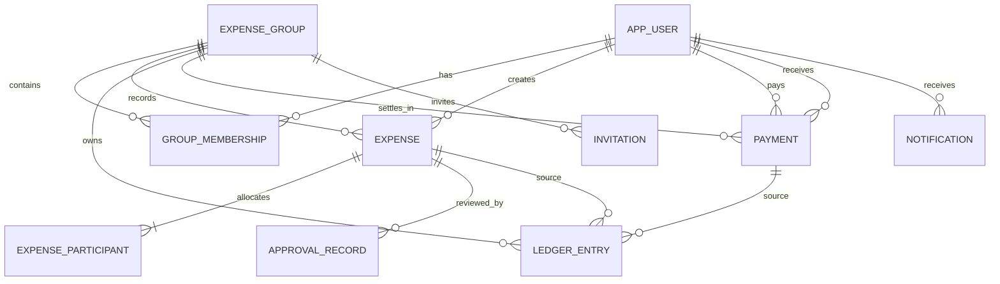

# Data Model and Persistence Strategy

## Relational model

The schema is normalized for source facts. All tables use opaque primary keys. Monetary columns are `DECIMAL(19,2)` (or an equivalent exact decimal type); percentages use `DECIMAL(7,4)` pending a product precision decision. Database decimal values map to `BigDecimal`, never `double`/`float`. Persist currency code alongside every amount or via an immutable group-currency relationship. Groups default to one currency for MVP.

Principal tables and important columns:

- `app_user(user_id, normalized_login, display_name, status, created_at, version)`; authentication secret material resides in an auth adapter table/provider, not in report queries.
- `expense_group(group_id, name, currency_code, approval_policy, created_by, created_at, version)`.
- `group_membership(membership_id, group_id, user_id, role, status, invited_by, joined_at, version)`; unique `(group_id,user_id)` for one current membership; status history retained via audit events.
- `invitation(invitation_id, group_id, invitee_login_hash, invited_by, status, expires_at, decided_by, version)`; never expose invitee existence to unauthorized callers.
- `expense(expense_id, group_id, creator_id, payer_id, currency_code, total, incurred_on, description, split_method, status, receipt_key, version, created_at, submitted_at)`.
- `expense_participant(expense_id, ordinal, user_id, share_amount, percentage, included)`; primary key `(expense_id,user_id)` and unique `(expense_id,ordinal)`; store calculated share and inputs for audit.
- `approval_record(approval_id, expense_id, reviewer_id, decision, reason, decided_at, submission_version)`; immutable and unique for decision policy as resolved.
- `payment(payment_id, group_id, payer_id, payee_id, currency_code, amount, status, idempotency_key, created_at, recorded_by, version)`; unique `(group_id,idempotency_key)`.
- `ledger_entry(entry_id, group_id, currency_code, source_type, source_id, posting_key, account_user_id, counterparty_user_id, signed_amount, effective_at, recorded_at, actor_id, reverses_entry_id)`; unique `(group_id,posting_key,account_user_id)`; entries for each transaction net to zero.
- `notification(notification_id, recipient_id, group_id, event_id, kind, created_at, read_at, delivery_status)`; unique `(recipient_id,event_id)`.
- `outbox_event(event_id, aggregate_type, aggregate_id, event_type, payload, created_at, claimed_at, delivered_at, attempts)`.
- `audit_event(audit_id, actor_id, group_id, entity_type, entity_id, action, occurred_at, correlation_id, safe_metadata)`; no secrets or unnecessary receipt contents.

`Balance` and `Report` are projections/views derived from ledger entries, expenses, and payments. They are not authoritative mutable tables. An optional `balance_projection` can be added with a last-applied ledger sequence and deterministic rebuild path.

## Constraints and indexes

- Foreign keys link expenses, participants, memberships, approvals, payments, notifications, and source entries. Keep historical user/group references addressable; use deactivation/anonymization policy rather than cascading deletion of financial facts.
- Check constraints enforce positive expense/payment amounts, allowed statuses, and valid enum-like values. Percentage sum and cross-row membership constraints require application transaction checks or triggers; validate at command time.
- Index `(group_id, incurred_on)` on expenses; `(group_id, status, created_at)` for review queues; `(group_id, account_user_id, effective_at)` and `(group_id, counterparty_user_id)` on ledger; `(recipient_id, created_at)` on notifications; unique source posting keys and idempotency keys.
- Use parameterized queries, bounded page sizes, and scoped predicates in every query. Do not fetch by entity ID alone before authorization.

## Database recommendation and trade-offs

Use SQLite for the Java Swing MVP's local, single-install data profile: it is embedded, simple to distribute, and designed for device-local/application-file use. It supports transactions and is appropriate where writes can serialize and the data file is local. SQLite documents that client/server engines are preferable for many networked clients or higher concurrent writer demands ([SQLite appropriate uses](https://www.sqlite.org/whentouse.html), [SQLite atomic commit](https://www.sqlite.org/atomiccommit.html)).

For future web/mobile access, use PostgreSQL behind a server-side application. It provides a centralized client/server model with concurrency control and transaction isolation mechanisms suited to multiple clients ([PostgreSQL concurrency control](https://www.postgresql.org/docs/current/mvcc.html)). These profiles share domain/application contracts but require different persistence adapter configuration and deployment operations. Do not configure end-user desktop apps to connect directly to PostgreSQL.

Trade-off: SQLite minimizes MVP setup but does not itself provide shared multi-device synchronization. PostgreSQL supports centralized concurrent access but requires service operations, backups, migrations, monitoring, and secured network access. A single SQLite database copied between devices is not a synchronization strategy.

## Transaction and migration strategy

Repositories in one adapter share a connection through `UnitOfWork`. Approval and payment posting commit source state, immutable ledger rows, audit records, idempotency keys, and outbox events atomically. On failure, all roll back. Lock or compare aggregate versions and retry only known transient serialization/lock failures with the same idempotency key. PostgreSQL optimistic locking plus row locking for settlement reservations is suitable; SQLite write transactions serialize writers.

Use versioned forward-only migrations, bundled with desktop app and server deployment. Record applied version/checksum, take a verified backup before destructive/transforming migrations, and test upgrade from previous supported schema. Seed only non-production demo/test data. Back up SQLite files using a consistent database backup mechanism; hosted PostgreSQL requires scheduled encrypted backups and tested point-in-time recovery. Retention and recovery objectives are operational decisions not specified yet.

## Connection and image handling

For desktop SQLite, open short-lived connections or a small managed pool and never block the Swing event dispatch thread. Configure foreign keys and a bounded busy timeout consistently. Hosted mode uses a server-side pool with limits. Receipt images are not stored as SQL blobs by default: save opaque keys, media type, size, checksum, and uploader. Enforce file size/type limits and authorize every retrieval. Local file backups must be coordinated with DB backups.
