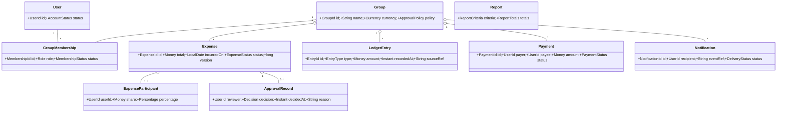
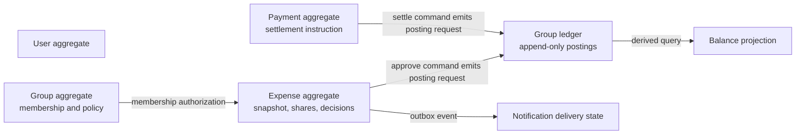

# Domain Model

## Design principles

The domain is framework-independent. Aggregate roots protect invariants that must change atomically. Money is represented using `BigDecimal` plus an explicit currency code; binary floating point is forbidden. Persist exact decimal values and calculation inputs, with scale/rounding applied explicitly at allocation boundaries.

## Value objects

| Type | Decision | Invariant / rationale |
|---|---|---|
| `Money` | Yes | Amount plus ISO currency; arithmetic rejects mismatched currency; nonnegative/positive checks are named policies, not implicit constructor restrictions. |
| `Percentage` | Yes | Decimal percentage in `[0,100]`; allocation set must total exactly `100.00` at defined precision. |
| `ExpenseSplit` | Yes | Immutable split method and ordered participant allocations; sum must equal expense total. |
| `BalanceAmount` | Yes | Signed net amount in one currency, derived from posted ledger entries; never independently edited. |
| `UserId` | Yes | Opaque stable identifier, not an email or display name. |
| `GroupId` | Yes | Opaque stable identifier. |
| `ExpenseId`, `PaymentId`, `MembershipId` | Yes | Opaque identifiers support references and idempotent commands. |

## Entities and aggregates

`User` owns account identity/profile lifecycle, but authentication credentials may be delegated behind an authentication port. `Group` owns membership and group policy. `Expense` owns its participants, submission state, and approval history because the decision is meaningful only in the context of a particular immutable submission. `Payment` records settlement intent and posting state. `LedgerEntry` is an append-only financial fact. `Balance` and `Report` are read models, not independently mutable aggregates.

## Aggregate boundaries and consistency

Avoid one enormous `Group` aggregate: expense histories can grow without bound. Commands validate group membership/policy and update the target aggregate plus the ledger/outbox in one relational transaction. Use optimistic `version` checks for expense state and database uniqueness constraints for posting identity. Membership and expense writes can race; the command validates active membership at commit time or uses a transaction/locking strategy that prevents a stale authorization decision.

## Expense and approval rules

- Expense creation captures group, creator, payer, incurred date, description, currency, split method, participant IDs, exact shares, and optional receipt reference. A snapshot preserves the participants and calculation even if membership later changes.
- Reject non-positive total, participants outside the group, empty participants, payer outside the group, invalid percentage values, and percentages not totaling exactly 100% at defined percentage precision.
- Equal split: divide in deterministic participant order; round each non-final share to two decimals with `HALF_UP`; assign the exact remainder to the final participant. Percentage split uses the same final-participant remainder rule. Persist participant order.
- Require at least one eligible designated reviewer other than the submitter, unless product policy explicitly permits self-approval. That policy is an unresolved decision; safe default is no self-approval.
- Rejection records reviewer, timestamp, and reason; it creates no financial ledger posting. Approval records the decision and creates postings once. Expense payload and shares are immutable after submission; corrections use a replacement/reversal record, preserving history.
- Notifications are generated at creation for every group member per FR-007, including recipients excluded from participation. Content must not disclose inaccessible data; current membership/access is rechecked when viewed.

## Ledger and balance meaning

For an approved expense, record balanced postings that represent payer credit and each participant's obligation. For participant `i`, expense share `s_i`, payer `p`: participant owes payer `s_i`, except payer's own share offsets their credit. The sum of group postings for an expense is zero. A payment from debtor to creditor posts equal and opposite amounts and references the outstanding obligation(s). No balance row is directly edited.

Ledger entries include stable IDs, group, currency, source type/id, posting sequence, signed amount, effective date, recorded timestamp, actor, and reversal reference. Unposted pending/rejected expenses do not enter the ledger. Historical corrections append reversing and replacement entries; posted rows are not deleted or rewritten.

Payment settlement must identify payer, payee, amount, currency, and the intended open balance or allocation policy. Reject zero/negative payment and mismatched group/currency. Whether overpayment is rejected or carried as credit is unresolved; MVP default is reject amounts above the selected outstanding amount. Record payment as pending until the authorized workflow/confirmation policy is resolved; never silently infer an external bank transfer.

## Domain services, events, and errors

Domain policies/services: `ExpenseSplitPolicy`, `ExpenseApprovalPolicy`, `MembershipAuthorizationPolicy`, `SettlementPolicy`, and `BalanceProjectionPolicy`. Events include `ExpenseSubmitted`, `ExpenseApproved`, `ExpenseRejected`, `PaymentRecorded`, and `NotificationRequested`. Events are internal facts; delivery happens after commit through an outbox.

Expected domain errors include `InvalidMoney`, `CurrencyMismatch`, `InvalidPercentageTotal`, `ParticipantNotInGroup`, `ReviewerNotAuthorized`, `SelfApprovalNotAllowed`, `InvalidExpenseState`, `DuplicatePosting`, `InsufficientOutstandingBalance`, `ConcurrentModification`, and `IdempotencyConflict`. Application maps these to user-facing outcomes without exposing storage details.
