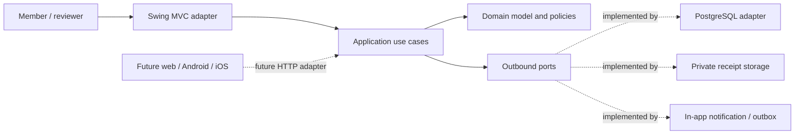
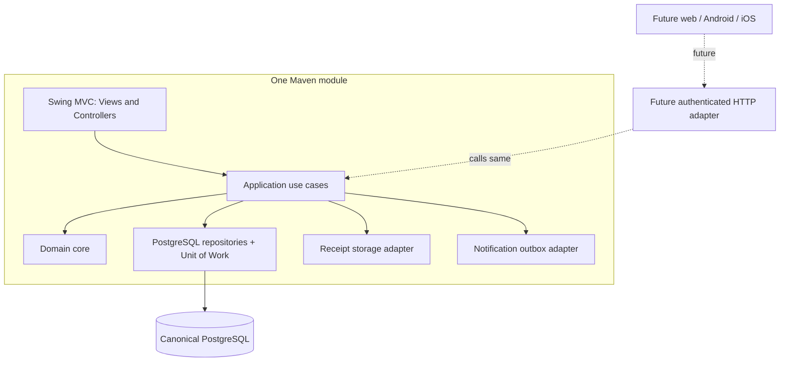

# Architecture Overview

## Architecture shape

SplitSmart is a single-process modular monolith organized as one Maven module. Clean/Hexagonal boundaries keep the domain independent of Java Swing, PostgreSQL, file storage, and external delivery providers. Dependency inversion is expressed through application-owned ports. This is enough structure to protect financial rules and allow a future HTTP adapter without creating multiple modules or services now.



## Responsibilities and dependency direction

| Boundary | Responsibility | Depends on |
|---|---|---|
| Domain | Entities, value objects, invariants, financial and membership policies | Java standard types only; no app framework or adapter |
| Application | Use cases, authorization orchestration, transaction coordination, boundary DTOs and ports | Domain |
| Presentation adapter | Swing Views, Controllers, view models, input feedback | Application inbound ports |
| Infrastructure adapters | PostgreSQL repositories, Unit of Work, receipt storage, authentication, notification delivery | Application ports and domain types |
| Bootstrap | Configuration and object wiring | All concrete parts; composition only |

Dependencies point inward: domain has no dependencies on application or adapters; application has no dependencies on Swing, JDBC, provider SDKs, or file APIs. Controllers may perform presentation validation and map outcomes, but domain/application validation is authoritative. Services do not return database rows or Swing types.

## Practical package organization

```text
src/main/java/com/splitsmart/
  domain/             entities, value objects, policies, domain errors
  application/        use cases, ports, commands, query results
  adapter/in/swing/   views, controllers, view models, navigation
  adapter/out/jdbc/   repositories, row mapping, UnitOfWork
  adapter/out/files/  receipt storage
  adapter/out/notify/ notification outbox and delivery
  bootstrap/          configuration and composition root
src/test/java/com/splitsmart/
  domain/ application/ adapter/
```

This is a conceptual organization, not a request to create source files. MVC is confined to the Swing adapter: views render, controllers translate interaction, and use cases own application workflows.

## Swing and future platform boundary

The Swing MVP invokes application ports in-process and uses PostgreSQL through the persistence adapter. Database credentials and SQL access must be limited to the trusted application process; do not expose a database endpoint to arbitrary desktop clients. If the MVP is deployed to multiple users, a secured server-side application boundary is required. A later web/mobile delivery adds an HTTP adapter that calls the same use cases. Whether the MVP is installed as a single trusted process or operates as a client of a service is an open deployment decision in [open decisions](open-decisions.md).



No microservices, event-sourced platform, or distributed ledger is proposed. The ledger is an append-only financial record inside a relational database, not an external blockchain or event-sourcing framework.

