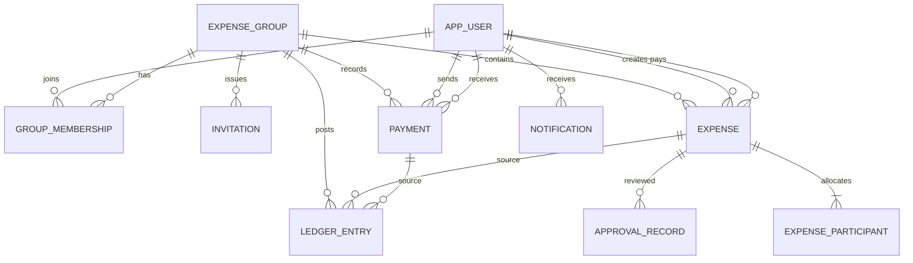

# Data Model

## Canonical store

PostgreSQL is the sole canonical database for authoritative shared user, group, expense, payment, and ledger facts. SQLite and H2 are not alternate profiles. This avoids separate migration semantics and makes the data model match concurrent multi-user access. No claim is made here that an operational production deployment has been selected or configured; deployment, backup, security, and recovery decisions remain necessary.

Amounts use an exact `NUMERIC(19,2)` proposal and map to Java `BigDecimal`. Percentages use exact numeric precision; proposed four decimal places await product confirmation. Currency is stored with each financial aggregate/posting. The proposed MVP restricts each group to one currency.

## Relational entities

| Table | Key facts |
|---|---|
| `app_user` | Stable ID, normalized login, display name, status, timestamps, version; no raw password. |
| `expense_group` | ID, name, currency, approval policy, creator, version. |
| `group_membership` | Group/user, role, lifecycle status, inviter, timestamps, version; unique current `(group_id,user_id)`. |
| `invitation` | Group, target account identity reference, inviter, status, expiry, decision actor/time. |
| `expense` | Group, `created_by`, **`payer_id`**, currency, positive total, incurred date, description, split type, status, receipt key, version. |
| `expense_participant` | Expense, ordinal, user, exact share, optional input percentage; unique participant and ordinal per expense. |
| `approval_record` | Expense, reviewer, decision, reason, timestamp, submitted version; immutable. |
| `payment` | Group, **`payer_id`**, **`payee_id`**, currency, amount, payment date, lifecycle status, idempotency key, recorder, version. |
| `ledger_entry` | Group/currency, source type and ID, posting key, account and counterparty, signed amount, effective/recorded times, actor, reversal reference. |
| `notification` / `outbox_event` | Recipient/event delivery state; unique recipient-event; durable delivery intent. |
| `audit_event` | Actor, action, entity reference, timestamp, correlation ID, safe metadata. |

`Balance` and `Report` are query models, not authoritative tables. A cached balance projection is optional, must identify its ledger sequence, and must be rebuildable from `ledger_entry`.

## Integrity constraints and query patterns

Use foreign keys and restrict deletion of financial history. Deactivate or anonymize accounts according to an approved retention policy rather than cascade-deleting ledger facts. Check constraints enforce positive totals, valid status values, distinct payer/payee, and nonzero ledger amounts. Cross-row conditions such as participant membership and percentage totals are validated in application transactions.

Key indexes: expense `(group_id, incurred_on)` and `(group_id,status,created_at)`; membership `(group_id,user_id,status)`; ledger `(group_id,account_user_id,effective_at)` and `(group_id,counterparty_user_id)`; notification `(recipient_id,created_at)`; unique idempotency key per group; unique source posting key per account. All reads apply group scope and bounded pagination.

Versioned migrations are the schema change mechanism. Database connections are managed by the adapter; transactions span aggregate state, ledger, audit, idempotency, and outbox changes. Receipt bytes live in private storage, with key/hash/media type/size in SQL. Backups must cover database and receipt storage consistently. Backup retention and recovery objectives remain open.

