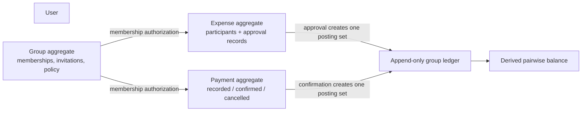
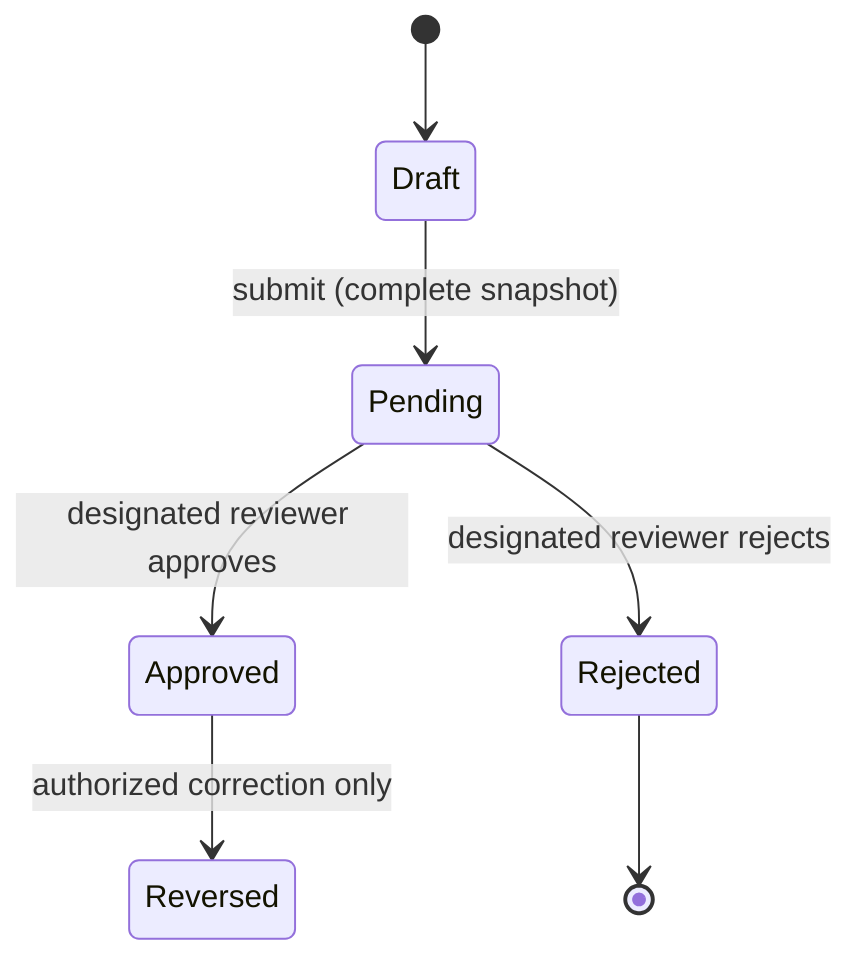
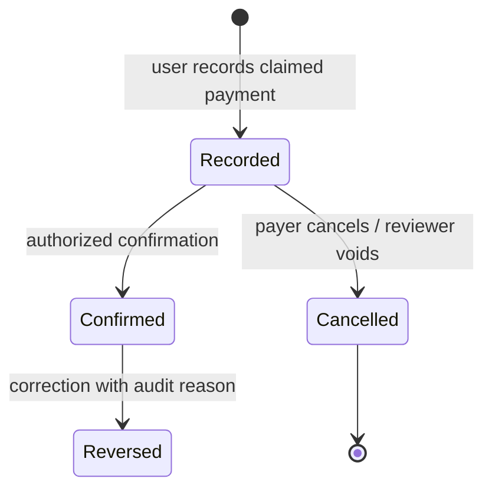

# Domain Model

## Core concepts

| Concept | Kind | Responsibility |
|---|---|---|
| User | Entity | Account identity/profile; authentication secrets belong to the authentication adapter. |
| Group | Aggregate root | Shared expense context, currency, approval policy, and membership policy. |
| GroupMembership | Entity within group boundary | User's role/status in one group, including invited, active, suspended, or left state. |
| Invitation | Entity | Invitation to a known user identity; approval/acceptance binds membership to that account. |
| Expense | Aggregate root | Immutable submitted expense facts, payer, split inputs/outputs, status, and receipt reference. |
| ExpenseParticipant | Entity/value within Expense | Ordered participant identity and calculated share; the saved snapshot does not change with later membership edits. |
| ApprovalRecord | Immutable entity | Reviewer decision, actor, reason, time, and submission version. |
| Payment | Aggregate root | Record of claimed payment and confirmation lifecycle; does not reduce debt until confirmed. |
| LedgerEntry | Immutable financial fact | Balanced debit/credit posting from an approved expense, confirmed payment, or correction. |
| Balance | Derived read model | Pairwise or net amount computed from posted ledger entries; never independently edited. |
| Notification | Delivery/read model | Durable recipient notification generated from committed business events. |
| Report | Query result | Scoped summary over source facts and ledger at a stated as-of time; not a financial authority. |

## Value objects and invariants

`Money(amount: BigDecimal, currency)` requires exact decimal arithmetic and one currency per operation. `Percentage` is bounded and has an explicit accepted scale. `ExpenseSplit` contains method, participant order, input percentages if used, and finalized shares. `UserId`, `GroupId`, `ExpenseId`, `PaymentId`, `EntryId`, and `IdempotencyKey` are opaque identifiers. `BalanceAmount` is signed but derived.

Rules: expense/payment amounts are positive; payer and participants must be active members at submission; the participant set is explicit and defaults to all eligible members except exclusions; percentage splits total exactly 100% at accepted precision; each share is rounded to two decimals, with the final participant absorbing the remainder; only approved expenses and confirmed payments post ledger entries.

The chosen percentage precision and rounding mode are proposals awaiting confirmation: four decimal places and `HALF_UP`. Currency is one per group in the proposed MVP. These assumptions are listed in [open decisions](open-decisions.md).

## Aggregate boundaries

Expense and its approval records share an aggregate because the decision governs that specific expense snapshot. Group memberships are bounded by Group, but full expense histories are separate aggregates to avoid an unbounded group object. Approval or payment posting updates its source aggregate and ledger entries atomically in one database transaction. Balance is a projection, optionally cached with a rebuild path.

## Expense lifecycle

Pending and rejected expenses have no ledger effect. Approval requires a designated reviewer. Self-approval is prohibited in the proposed policy. Group configuration of whether approval can be disabled remains open; until resolved, the safe default is approval required. An approved expense is immutable; correction is represented by reversal and replacement, retaining original approval and ledger history.

## Payment lifecycle

Only `Confirmed` posts a ledger settlement and reduces outstanding debt. Who may confirm and whether an external proof is required are open decisions. A payment record is preserved if cancelled; confirmed records are corrected by reversal, never deletion.

