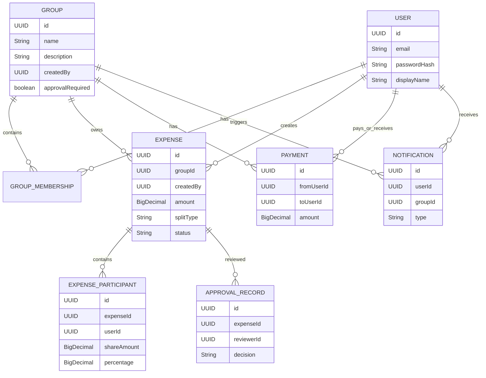

# Data Model: SplitSmart Expense Tracking

## Domain Model Overview

The domain model is centered on groups, users, shared expenses, approval history, balances, settlements, and notifications. The key design principle is that the domain model owns the rules and invariants while the persistence layer simply stores and retrieves them.

## Core Entities

### User

Represents a person with an account that can authenticate and participate in shared groups.

| Field | Type | Notes |
|---|---|---|
| id | UUID | Primary key |
| email | String | Unique login identifier |
| passwordHash | String | Salted hash, never plain text |
| displayName | String | Human-readable name |
| createdAt | Timestamp | Created when account is created |
| status | Enum | Active, pending, disabled |

### Group

A shared space for a set of users managing expenses and balances.

| Field | Type | Notes |
|---|---|---|
| id | UUID | Primary key |
| name | String | Group name |
| description | String | Optional summary |
| createdBy | UUID | User who created the group |
| createdAt | Timestamp | Creation date |
| approvalRequired | boolean | If true, expenses wait for reviewer approval |

### GroupMembership

Defines a user’s membership and role within a group.

| Field | Type | Notes |
|---|---|---|
| id | UUID | Primary key |
| groupId | UUID | FK to Group |
| userId | UUID | FK to User |
| role | Enum | Member, admin, reviewer |
| status | Enum | Invited, approved, active, blocked |
| joinedAt | Timestamp | Date membership became active |
| invitedBy | UUID | Optional user who invited the member |

### Expense

Represents a shared cost recorded within a particular group.

| Field | Type | Notes |
|---|---|---|
| id | UUID | Primary key |
| groupId | UUID | FK to Group |
| createdBy | UUID | User who created the expense |
| description | String | Human-readable summary |
| amount | BigDecimal | Must be > 0 |
| currency | String | Example: USD |
| expenseDate | LocalDate | When the expense was incurred |
| splitType | Enum | EQUAL or PERCENTAGE |
| receiptImagePath | String | Optional image reference |
| status | Enum | Draft, pending, approved, rejected |
| createdAt | Timestamp | Creation timestamp |

### ExpenseParticipant

Represents the per-user distribution of an expense, including share amount and percentage.

| Field | Type | Notes |
|---|---|---|
| id | UUID | Primary key |
| expenseId | UUID | FK to Expense |
| userId | UUID | FK to User |
| shareAmount | BigDecimal | Final amount assigned to the participant |
| percentage | BigDecimal | Used for percentage split mode |
| includedInExpense | boolean | Excluded users are not part of this record |
| roundingAdjustment | BigDecimal | Optional difference used to match final cents |

### ApprovalRecord

Captures the review decision for a pending expense.

| Field | Type | Notes |
|---|---|---|
| id | UUID | Primary key |
| expenseId | UUID | FK to Expense |
| reviewerId | UUID | FK to User |
| decision | Enum | Approved or rejected |
| reviewNote | String | Optional note |
| reviewedAt | Timestamp | Decision timestamp |

### Payment

Represents a settlement or repayment between users in a group.

| Field | Type | Notes |
|---|---|---|
| id | UUID | Primary key |
| groupId | UUID | FK to Group |
| fromUserId | UUID | Payer |
| toUserId | UUID | Recipient |
| amount | BigDecimal | Must be > 0 |
| paymentDate | LocalDate | Date payment occurred |
| note | String | Optional memo |
| createdAt | Timestamp | Ledger audit time |

### Balance

A derived balance or snapshot view used to calculate each user’s net position relative to other users. It may be persisted as a materialized view or recalculated from the ledger for accuracy.

| Field | Type | Notes |
|---|---|---|
| userId | UUID | The user whose balance is evaluated |
| counterpartUserId | UUID | Other user in same group |
| groupId | UUID | Group membership context |
| netAmount | BigDecimal | Positive means owed to them, negative means they owe |
| updatedAt | Timestamp | Last recalculated time |

### Notification

Tracks user notifications emitted by the system.

| Field | Type | Notes |
|---|---|---|
| id | UUID | Primary key |
| groupId | UUID | Related group |
| userId | UUID | Intended recipient |
| relatedExpenseId | UUID | Optional related expense |
| type | Enum | ExpenseCreated, ApprovalRequested, ApprovalDecision |
| isRead | boolean | Read/unread state |
| createdAt | Timestamp | Message timestamp |

### Report

A generated summary object, not necessarily a core database table unless the product later chooses a persisted reporting model.

| Field | Type | Notes |
|---|---|---|
| id | UUID | Report identity |
| userId | UUID | Report owner |
| groupId | UUID | Optional group scope |
| startDate | LocalDate | Range start |
| endDate | LocalDate | Range end |
| summary | JSON | Summary data for totals and balances |
| generatedAt | Timestamp | Report creation time |

## Business Rules and Invariants

- Expense amount must be greater than zero.
- Split type is limited to `EQUAL` or `PERCENTAGE`.
- Percentage-based expenses must total 100% exactly.
- Money is represented as `BigDecimal` with two-decimal currency precision.
- Rounding is defined per-share; any leftover cents are assigned to the last participant in sorted order.
- Only approved expenses may affect balances.
- Only designated group admins/reviewers may approve or reject expenses.
- Group data is isolated by group membership and authorization checks.
- Payment operations must adjust the appropriate net balances and keep an audit trail.
- Notification generation is group-based and should occur when a new expense is created.

## Database Design Notes

### Transactional patterns
- Use a single transaction for expense creation and approval changes to maintain integrity between `Expense`, `ExpenseParticipant`, and `ApprovalRecord` updates.
- Use transactional boundaries around payment settlement to ensure the payment record and balance adjustment happen atomically.
- For large reporting jobs, compute from immutable ledger tables rather than ephemeral in-memory state.

### Constraints
- Unique user email
- Unique group membership per user/group
- Validation of non-negative or positive money values at the service and database layers
- Foreign key constraints between all related tables
- Check constraints for percentage totals and non-zero amounts where feasible

### Query patterns
- `ExpenseRepository.findByGroupId(groupId)` for group expense history
- `BalanceRepository.findByGroup(groupId, userId)` for ledger queries
- `PaymentRepository.findByGroupAndDateRange(groupId, start, end)` for report generation
- `NotificationRepository.findUnreadByUser(userId)` for notifications

## Entity Relationship Diagram

## Notes on Future API Design

The domain model is intentionally independent of Java Swing. A future web or mobile frontend would consume the same application services and repositories without needing to re-implement the money or group rules. That separation is a major architectural advantage of the proposed design.
