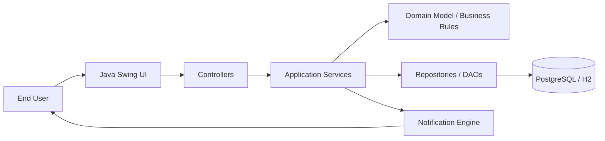
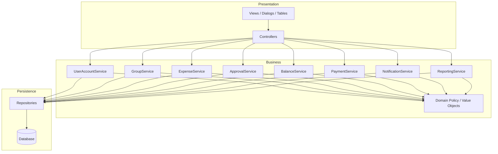
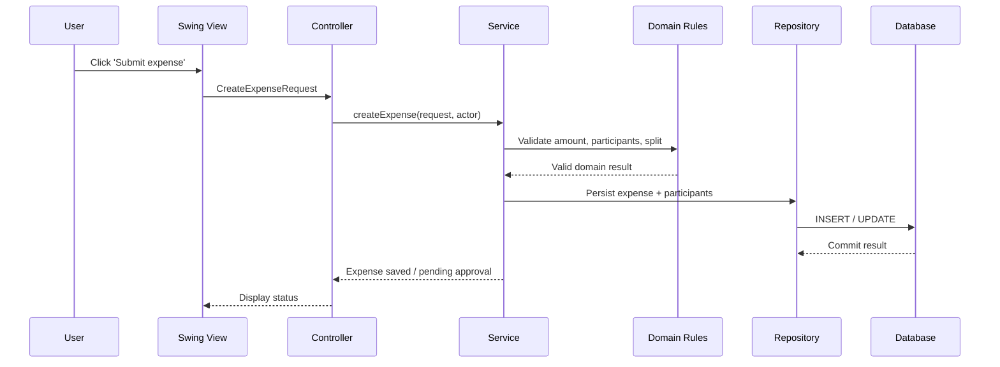
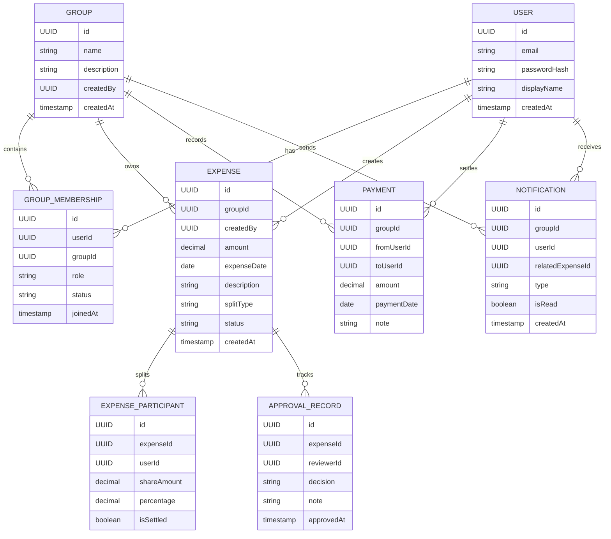
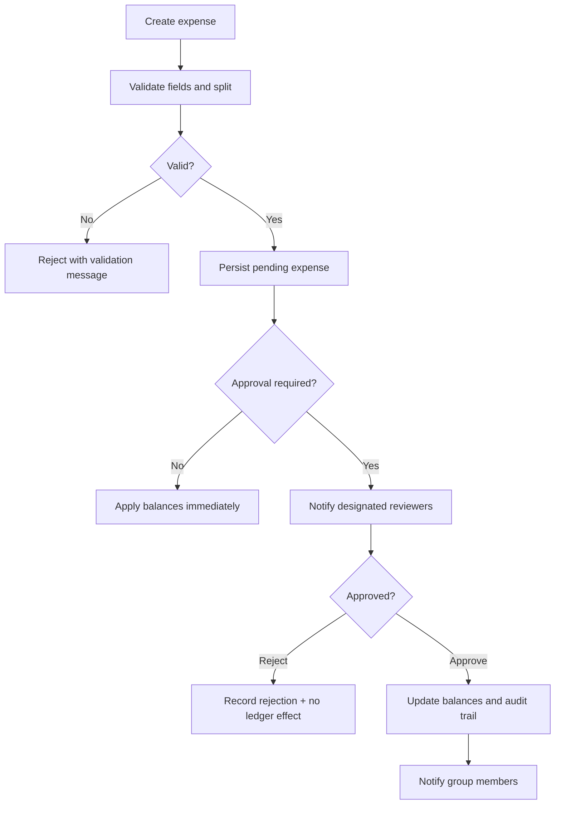
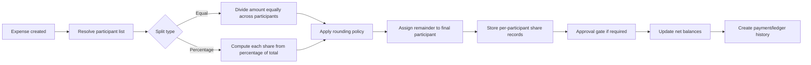

# Implementation Plan: SplitSmart Expense Tracking

**Branch**: `001-split-expense-tracking` | **Date**: 2026-11-05 | **Spec**: [spec.md](./spec.md)

## Summary

This architecture uses a layered MVC design centered on a Java 21, Maven-based Java Swing desktop application. The UI remains a thin presentation layer, while the domain model and business services own all financial rules such as split calculations, approvals, balance reconciliation, notifications, and reporting. The design supports the current desktop MVP while leaving the door open for a future web or mobile front end behind a common service and API boundary.

The architecture deliberately separates responsibilities:
- Presentation: Swing forms, tables, dialogs, and controllers
- Business logic: services and domain rules for users, groups, expenses, approvals, balances, payments, notifications, and reports
- Data access: repository interfaces plus persistence adapters and transaction boundaries
- Shared infrastructure: configuration, logging, validation, and auditing

## Technical Context

**Language/Version**: Java 21

**Primary Dependencies**: Maven, Java Swing, JUnit 5, PostgreSQL JDBC driver, SLF4J, H2 for local/test execution, PlantUML for diagrams

**Storage**: PostgreSQL as the primary production database for multi-user data; H2 for local development and integration tests when a lightweight in-memory or file-based database is desired

**Testing**: JUnit 5 for unit and integration tests; repository and service tests cover approval, balancing, and rounding rules

**Target Platform**: Desktop-first Java Swing application for Windows/macOS/Linux; future API-ready architecture for web and mobile use

**Project Type**: Desktop application with service-oriented internal architecture and latent API boundary for future expansion

**Performance Goals**: Support small-to-medium shared groups (dozens of users) with responsive balance and report generation; avoid N+1 queries through repository-level aggregation and history queries

**Constraints**:
- Money is tracked with `BigDecimal` and never with floating point
- Approval gates must block balance mutation until authorized
- Group membership and access must be strictly isolated by user and group
- Existing business requirements clearly separate the Swing MVP from wider product vision

## Constitution Check

This plan conforms to the SplitSmart constitution:

- Customer requirements remain authoritative and are traced to domain/business behavior.
- Object-oriented separation of concerns is preserved between Swing UI, controllers, services, and persistence.
- Monetary calculations are defined with `BigDecimal` and explicit rounding policy.
- All requirements map to testable evidence, especially approval logic, expense calculations, and balance reconciliation.
- The architecture keeps the GUI independent from authoritative financial rules.

## Project Structure

```text
specs/001-split-expense-tracking/
├── spec.md
├── plan.md
├── research.md
├── data-model.md
├── quickstart.md
├── contracts/
│   └── service-contracts.md
└── checklists/
    └── requirements.md

src/
├── main/
│   ├── java/com/splitsmart/
│   │   ├── app/
│   │   │   └── SplitSmartApplication.java
│   │   ├── presentation/
│   │   │   ├── swing/
│   │   │   │   ├── views/
│   │   │   │   ├── dialogs/
│   │   │   │   └── tables/
│   │   │   └── controllers/
│   │   ├── service/
│   │   │   ├── UserAccountService.java
│   │   │   ├── GroupService.java
│   │   │   ├── ExpenseService.java
│   │   │   ├── ApprovalService.java
│   │   │   ├── BalanceService.java
│   │   │   ├── PaymentService.java
│   │   │   ├── NotificationService.java
│   │   │   └── ReportingService.java
│   │   ├── domain/
│   │   │   ├── model/
│   │   │   ├── policy/
│   │   │   └── value/
│   │   ├── persistence/
│   │   │   ├── repository/
│   │   │   ├── dao/
│   │   │   └── jdbc/
│   │   ├── validation/
│   │   ├── audit/
│   │   └── config/
│   └── resources/
│       └── application.properties
└── test/
    └── java/com/splitsmart/
        ├── service/
        ├── persistence/
        └── integration/
```

**Structure Decision**: The project uses a single Maven module with a layered package structure. This keeps desktop domain logic, service rules, and persistence contracts simple while preserving the option to split into a separate API or web module later.

## Proposed Architecture

### 1. Presentation Layer

The Swing layer is intentionally thin; it communicates through controllers and service interfaces rather than directly persisting data or performing balance reconciliation.

Responsibilities:
- Render screens for authentication, group management, expense entry, approval review, balances, payments, notifications, and reports
- Validate user input before calling services
- Delegate to controllers and service methods
- Surface errors, warnings, and success states to users

### 2. Controller Layer

Controllers coordinate user actions and view state transitions. They map UI events to service calls and present domain exceptions in a user-friendly manner.

Examples:
- `LoginController`
- `GroupController`
- `ExpenseController`
- `ApprovalController`
- `BalanceController`
- `PaymentController`
- `ReportController`

### 3. Service Layer

This layer contains the system’s authoritative business logic. It is the primary home for all rules that affect money, approvals, group access, notifications, and audit history.

Core services:
- `UserAccountService` for signup, login, and profile access
- `GroupService` for membership, invites, group membership approval, and authorization checks
- `ExpenseService` for expense creation, validation, split calculation, and persistence
- `ApprovalService` for review, approval, rejection, and activity audit
- `BalanceService` for net position and ledger derivation
- `PaymentService` for settlement recording and balance adjustment
- `NotificationService` for expense notifications to group members
- `ReportingService` for date-range summaries and exports

### 4. Domain / Model Layer

The domain model owns invariants that make the system reliable for financial records. This is where the money rules live, independent of Java Swing and database implementation details.

Key entities:
- `User`
- `Group`
- `GroupMembership`
- `Expense`
- `ExpenseParticipant`
- `ApprovalRecord`
- `Balance`
- `Payment`
- `Notification`
- `Report`

### 5. Persistence Layer

Repositories and DAOs isolate the application from the database. The service layer depends on abstractions, not on JDBC or a concrete database type. This keeps financial logic portable and easier to test.

Responsibilities:
- translate domain objects into persisted records
- enforce database-level constraints and transaction boundaries
- maintain audit history and immutable event records
- expose efficient queries for group balances, user ledgers, and reports

## System Context Diagram



## Component Architecture Diagram



## Layer Interaction Diagram



## Entity Relationship Diagram



## Expense Approval Workflow



## Expense Splitting and Balance Calculation Workflow



## Key Architectural Decisions

### Decision 1: Layered MVC with service-oriented domain rules
- Decision: Use Swing views/controllers in presentation; keep domain and services independent from GUI.
- Why: Simplifies validation, testing, and future API evolution without coupling financial rules to the UI.
- Alternatives considered: direct Swing model logic, full MVC only without service layer, and monolithic controller classes.
- Trade-offs: Slightly more classes and interfaces, but significantly greater maintainability and auditability.

### Decision 2: PostgreSQL as the canonical relational database
- Decision: Use PostgreSQL for the multi-user production system; H2 for local and test execution where convenient.
- Why: Strong transactional support, concurrency control, and reporting fit the product’s financial and auditing needs.
- Alternatives considered: SQLite, H2 only, and filesystem-based storage.
- Trade-offs: More operational setup than SQLite, but stronger reliability for concurrent group activity and future web deployment.

### Decision 3: BigDecimal-centered money model
- Decision: All money values use `BigDecimal` and explicit rounding rules.
- Why: Required for deterministic financial correctness and auditable calculations.
- Alternatives considered: `double`, `float`, or hidden rounding in UI code.
- Trade-offs: More verbose code and careful unit testing, but correct monetary behavior.

## Major Risks and Trade-offs

- Approval and notification flows can become inconsistent if the workflow is not enforced in the same transactional scope as balance updates.
- Reporting logic must avoid double counting historical balances or pending approvals.
- Future web/mobile implementations will require API contracts and session management; these are intentionally out of scope for the Swing MVP.
- Group membership rules must be enforced consistently both in the UI and at the service/repository layer.

## Outstanding Architectural Decisions

- Whether the desktop product will ship with a direct embedded database or a client/server architecture from the start
- Whether approval rules are group-specific or user-role-specific per group configuration
- Whether notifications are persisted records, in-app messages, or both
- Whether reports are generated synchronously at request time or cached in a materialized reporting table

These items are intentionally left as implementation-level decisions after architecture sign-off, because they do not alter the underlying product requirements or the layered design.

## How the Design Satisfies Existing Requirements

- User accounts: implemented through `UserAccountService` and persistent `User` model
- Group management: `GroupService` and `GroupMembership` model
- Expense creation: `ExpenseService` with participant and split logic
- Approval workflow: `ApprovalService` and `ApprovalRecord`
- Balance tracking: `BalanceService` and ledger-oriented persistence
- Payment tracking: `PaymentService` and payment history
- Notifications: `NotificationService` and notifications to group members
- Reporting: `ReportingService` with date-range and summary data access
- Cross-platform future-ready design: presentation layer is isolated from shared business services, enabling a future API-backed web or mobile frontend without rewriting the money rules

The design remains intentionally focused on the Java Swing desktop MVP while preserving the reusable domain, service, and persistence contracts needed for future platform expansion.
